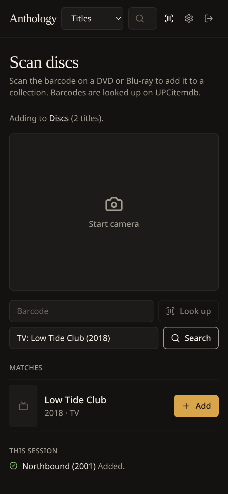

# Anthology

A catalogue that pulls the libraries of your media servers into one searchable collection. Each title links back to the server that has it, so playback still happens there.


## What works today

**Sources**

- Plex and Jellyfin servers (movies and TV shows), added and tested from Settings
- Digital collections: paste a list of titles you own, such as Apple TV purchases or DVDs, or scan disc barcodes with your phone
- Streaming catalogues for over 30 services, from Netflix, Prime Video, Disney+, Hulu, Apple TV+, HBO Max, Paramount+ and Peacock to free services such as Tubi and Pluto TV, live TV services, and regional ones such as BBC iPlayer, Crave and Stan: everything each service you tick includes in your region
- A sample-data source for trying the app without a server (dev only, unless `ENABLE_MOCK_SOURCES=true`)

**Library**

- One entry per title, merged across sources by external ID (TMDB, IMDb, TVDB), then by normalized title and year
- Search by title, actor, or director and show creator, with results updating as you type
- Sort by rating (the default), newest or title, and filter by movies or shows, genre, minimum rating, source and streaming service
- Filters live in the address, so the back button and the title page's **Library** link return you to where you were
- Posters, ratings and genres from TMDB, including for titles that came without them

**Title pages**

- Rating, genres, runtime, summary, director (or creator) and top cast, with each name linking to their other titles in your library
- Every source that has the title, with a link to open it there. Streaming services open their own search for the title

**Running it**

- Full sync per source, on a schedule or with **Sync now**. Items removed from a source leave the library on the next sync
- Single admin password, set at first run or with `ADMIN_PASSWORD`
- Source credentials encrypted at rest with `SECRET_KEY`, and artwork fetched through the server so credentials never reach the browser

See [PROJECT.md](PROJECT.md) for the full plan, including music, manual merge and split, and the stretch adapters.

## Run locally

```sh
npm install
npm run dev
```

Open the app, create the admin password, then add a **Sample data** source in Settings (pick Alpha for one and Beta for another to see matching) and press **Sync now**.

Locally the database is a SQLite file in `./data`. Copy `.env.example` to `.env` to change settings.

## Deploy to Vercel

Anthology runs on Vercel with a Turso database (hosted libSQL, compatible with SQLite).

1. Create a database and an access token with the Turso CLI:

   ```sh
   turso db create anthology
   turso db show anthology --url
   turso db tokens create anthology
   ```

2. Import the repository in Vercel. The SvelteKit preset and `vercel.json` need no changes.
3. Set these environment variables, then deploy:

| Variable                | Required | Purpose                                                                     |
| ----------------------- | -------- | --------------------------------------------------------------------------- |
| `TURSO_DATABASE_URL`    | Yes      | The `libsql://` URL from Turso                                              |
| `TURSO_AUTH_TOKEN`      | Yes      | The Turso database token                                                    |
| `DATABASE_URL`          | No       | Overrides `TURSO_DATABASE_URL`. See the note below                          |
| `DATABASE_AUTH_TOKEN`   | No       | Token for `DATABASE_URL`                                                    |
| `ADMIN_PASSWORD`        | Yes      | Admin password. First-run setup is turned off on Vercel                     |
| `SECRET_KEY`            | Yes      | Encrypts source credentials. Changing it makes saved credentials unreadable |
| `CRON_SECRET`           | Yes      | Protects `/api/cron`. Vercel sends it with its scheduled requests           |
| `SYNC_INTERVAL_MINUTES` | No       | Minimum time between automatic syncs of a source. Default `360`             |
| `TMDB_READ_TOKEN`       | No       | TMDB read access token. Turns on streaming, posters, ratings and details    |
| `STREAMING_REGION`      | No       | Two-letter country code for streaming catalogues. Default `US`              |
| `ENABLE_MOCK_SOURCES`   | No       | `true` allows the sample-data source type in production                     |

The cron jobs in `vercel.json` run three times a day (06:00, 14:00 and 22:00 UTC). Each run syncs the sources that are due, least recently synced first, then checks streaming availability for titles you own. It stops starting new work after four minutes, inside the 300 second function limit. Anything left over is picked up by the next run or the buttons in Settings.

If you connect Turso through the Vercel Marketplace, check the database name at the bottom of Settings. A name starting with `dpl-` means each deployment has its own database, and the next deploy starts empty. Settings shows a warning when this happens. Set `DATABASE_URL` and `DATABASE_AUTH_TOKEN` to your main Turso database (`turso db show <name> --url`, `turso db tokens create <name>`) and redeploy. They take priority over the `TURSO_` values.

Limits on Vercel:

- Vercel cannot reach servers on your home network (addresses like `192.168.x.x`). Plex and Jellyfin sources only work if they have a public address, for example through a tunnel. Digital collections, streaming catalogues and sample data work as is.
- A single sync has to finish within the 300 second function limit.

## Run as a Node server

`npm run build` outside Vercel produces a Node server in `build/` (`node build`). It uses a local SQLite file unless `DATABASE_URL` or `TURSO_DATABASE_URL` is set, and runs scheduled syncs itself. The `Dockerfile` and `compose.example.yaml` package this for Docker hosts such as Dokploy. Set `ORIGIN` to the public URL behind a reverse proxy, and back up the data volume. Point sources at addresses the container can reach, for example `http://192.168.1.10:8096` for Jellyfin or `http://192.168.1.10:32400` for Plex. Jellyfin needs an API key from its dashboard. Plex needs an `X-Plex-Token`.

## Using Anthology

### Digital collections

Store purchases and physical media have no API Anthology can read, so add them as a **Digital collection** source in Settings and paste your titles, one per line:

```text
The Glass Orchard (2019)
Northbound
TV: Low Tide Club (2018)
```

- Prefix a show with `TV:`. Anything else is treated as a movie.
- Years are optional but make matching more reliable. Use the original release year, not the year of a DVD or re-release: a title only matches TMDB within one year of its original release.
- List the films in a box set one per line. A set name such as "Trilogy" or "Collection" has nothing to match.
- Lines starting with `#` are ignored. Use **Edit list** on the source to change the list later.

A title without a year joins an existing title only when exactly one matches. Titles TMDB cannot match still appear in the library, without a poster or rating.

### Scanning discs

Open **Scan** in the header on your phone, tap **Start camera** and point it at the barcode on a DVD or Blu-ray. Anthology looks the barcode up, shows the matching titles, and **Add** puts the one you pick into a digital collection. If you have no collection yet, the page offers to create one.



- The camera needs Chrome on Android and an `https://` address. Elsewhere, type the barcode or search by title on the same page.
- Barcodes are looked up on [UPCitemdb](https://www.upcitemdb.com/). Only the barcode digits are sent. Its free tier allows 100 lookups a day and about one every 10 seconds, so wait a moment between discs.
- Matches come from TMDB when `TMDB_READ_TOKEN` is set. Without it, the title read from the barcode is offered as is.
- A title already in the collection is not added twice. The disc format (DVD, Blu-ray, 4K) is shown but not stored.

### Streaming services

Create a free TMDB account, copy the API read access token from its API settings, and set it as `TMDB_READ_TOKEN`. Then tick the services you subscribe to under Settings and click **Save services**.

- Services are grouped into subscriptions, free and live TV. Regional services only appear when `STREAMING_REGION` is a country TMDB lists them in.
- Each ticked service becomes a source holding what it includes in your region, imported from TMDB and refreshed by the scheduled job. Store rentals and purchases, paid add-on channels and free tiers are left out. Unticking a service removes its catalogue.
- A large catalogue can take a while to import. If one is not finished after saving, use its **Sync now** button or wait for the scheduled job.
- Titles you own are marked when a service has them, either because they merge with a catalogue title or through **Check availability** (rechecked weekly).
- TMDB has no links to a title inside each service, so service links open the service's own search for the title, or its home page where search cannot be opened from a link.
- To add a service, add an entry to `src/lib/streaming-services.ts` with a pattern matching its TMDB provider name. Match the service itself, not the same catalogue resold as an Amazon, Apple TV or Roku channel.

This reflects what each service offers in your region, not what is in your account. TMDB's lists can lag behind the services, so expect the odd title that has just left or arrived. Streaming data comes from JustWatch via TMDB.

### Ratings and genres

Ratings are TMDB audience ratings out of 10. **Top rated** weighs each rating by its number of votes, so a title with a handful of perfect scores does not outrank a well-loved classic, and unrated titles sort last. The minimum-rating filter only counts titles with at least 25 votes. Ratings and genres arrive when a source syncs, or through **Check availability** for titles you own.

## Development

| Task        | Command          |
| ----------- | ---------------- |
| Dev server  | `npm run dev`    |
| Type check  | `npm run check`  |
| Lint        | `npm run lint`   |
| Format      | `npm run format` |
| Unit tests  | `npm test`       |
| Build       | `npm run build`  |
| Regen icons | `npm run icons`  |

## License

See [LICENSE](LICENSE).
