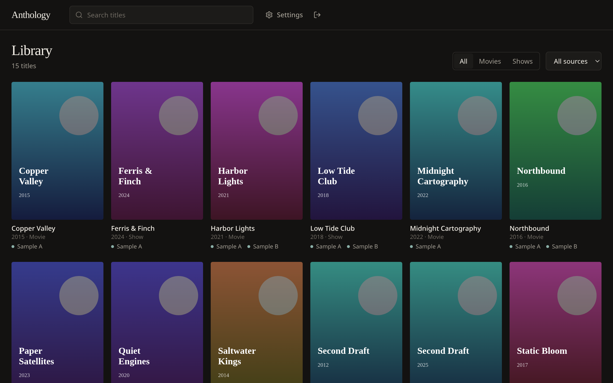

# Anthology

A catalogue that pulls the libraries of your media servers into one searchable collection. Each title links back to the server that has it, so playback still happens there.



## What works today

- Plex and Jellyfin sources (movies and TV shows), added and tested from the settings page
- A sample-data source for trying the app without a server (dev only, unless `ENABLE_MOCK_SOURCES=true`)
- Full sync per source, on a schedule or with **Sync now**. Items removed from a source leave the library on the next sync
- Matching across sources by external ID (TMDB, IMDb, TVDB), then by normalized title and year
- Library browse with search, kind filter and source filter
- Title pages listing every source that has the title, with a link to open it there
- Posters fetched through the server so source credentials never reach the browser
- Single admin password, set at first run or with `ADMIN_PASSWORD`
- Source credentials encrypted at rest with `SECRET_KEY`
- Digital collections: paste a list of titles you own on a store such as Apple TV, and they join the library like any other source
- Optional streaming catalogues for Netflix, Prime Video, Hulu, Disney+ and Apple TV+: everything each service you tick offers in your region joins the library, and titles you own are marked when a service has them

See [PROJECT.md](PROJECT.md) for the full plan, including music, manual merge and split, and the stretch adapters.

## Run locally

```sh
npm install
npm run dev
```

Open the app, create the admin password, then add a **Sample data** source in Settings (pick Alpha for one and Beta for another to see matching) and press **Sync now**.

Locally the database is a SQLite file in `./data`. Copy `.env.example` to `.env` to change settings.

## Deploy to Vercel

Anthology runs on Vercel with a [Turso](https://turso.tech) database (hosted libSQL, compatible with SQLite).

1. Create a database and an access token with the Turso CLI:

   ```sh
   turso db create anthology
   turso db show anthology --url
   turso db tokens create anthology
   ```

2. Import the repository in Vercel. The SvelteKit preset and `vercel.json` need no changes.
3. Set these environment variables, then deploy:

| Variable                | Required | Purpose                                                                     |
| ----------------------- | -------- | --------------------------------------------------------------------------- |
| `TURSO_DATABASE_URL`    | Yes      | The `libsql://` URL from Turso                                              |
| `TURSO_AUTH_TOKEN`      | Yes      | The Turso database token                                                    |
| `DATABASE_URL`          | No       | Overrides `TURSO_DATABASE_URL`. See the note below                          |
| `DATABASE_AUTH_TOKEN`   | No       | Token for `DATABASE_URL`                                                    |
| `ADMIN_PASSWORD`        | Yes      | Admin password. First-run setup is turned off on Vercel                     |
| `SECRET_KEY`            | Yes      | Encrypts source credentials. Changing it makes saved credentials unreadable |
| `CRON_SECRET`           | Yes      | Protects `/api/cron`. Vercel sends it with its scheduled requests           |
| `SYNC_INTERVAL_MINUTES` | No       | Minimum time between automatic syncs of a source. Default `360`             |
| `TMDB_READ_TOKEN`       | No       | TMDB read access token. Turns on streaming catalogues and lookups           |
| `STREAMING_REGION`      | No       | Country used for streaming availability. Default `US`                       |
| `ENABLE_MOCK_SOURCES`   | No       | `true` allows the sample-data source type in production                     |

The cron jobs in `vercel.json` run three times a day (06:00, 14:00 and 22:00 UTC). Each run syncs the sources that are due, least recently synced first, then checks streaming availability for titles you own. It stops starting new work after four minutes, inside the 300 second function limit. Anything left over is picked up by the next run or the buttons in Settings.

If you connect Turso through the Vercel Marketplace, check the database name at the bottom of Settings. A name starting with `dpl-` means each deployment has its own database, and the next deploy starts empty. Settings shows a warning when this happens. Set `DATABASE_URL` and `DATABASE_AUTH_TOKEN` to your main Turso database (`turso db show <name> --url`, `turso db tokens create <name>`) and redeploy. They take priority over the `TURSO_` values.

Limits on Vercel:

- Vercel cannot reach servers on your home network (addresses like `192.168.x.x`). Plex and Jellyfin sources only work if they have a public address, for example through a tunnel. Digital collections, streaming availability and sample data work as is.
- A single sync has to finish within the 300 second function limit.

## Run as a Node server

`npm run build` outside Vercel produces a Node server in `build/` (`node build`). It uses a local SQLite file unless `TURSO_DATABASE_URL` is set, and runs scheduled syncs itself. The `Dockerfile` and `compose.example.yaml` package this for Docker hosts such as Dokploy. Set `ORIGIN` to the public URL behind a reverse proxy, and back up the data volume. Point sources at addresses the container can reach, for example `http://192.168.1.10:8096` for Jellyfin or `http://192.168.1.10:32400` for Plex. Jellyfin needs an API key from its dashboard. Plex needs an `X-Plex-Token`.

### Digital collections

Store purchases (Apple TV, Amazon, Google and similar) have no API Anthology can read, so add them as a **Digital collection** source and paste your titles, one per line:

```text
The Glass Orchard (2019)
Northbound
TV: Low Tide Club (2018)
```

Years are optional but make matching more reliable. A title without a year joins an existing title only when exactly one matches. Use **Edit list** on the source to change it later.

### Streaming availability

Create a free TMDB account, copy the API read access token from its API settings, and set it as `TMDB_READ_TOKEN`. Then tick the services you subscribe to under Settings and save. Each ticked service becomes a source holding its subscription catalogue for your region, imported from TMDB and refreshed by the scheduled job. Unticking a service removes its catalogue. Titles you own are marked when a service has them: either they merge with a catalogue title, or the **Check availability** button looks them up (rechecked weekly). Titles without a TMDB ID, such as digital collection entries, are matched by exact title and year, and get their poster from TMDB once matched. All of this reflects what each service offers in your region, not what is in your account. Streaming data comes from JustWatch via TMDB.

## Development

| Task        | Command          |
| ----------- | ---------------- |
| Dev server  | `npm run dev`    |
| Type check  | `npm run check`  |
| Lint        | `npm run lint`   |
| Format      | `npm run format` |
| Unit tests  | `npm test`       |
| Build       | `npm run build`  |
| Regen icons | `npm run icons`  |

## License

See [LICENSE](LICENSE).
